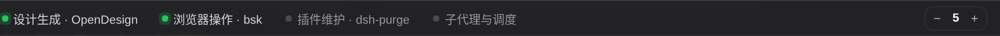
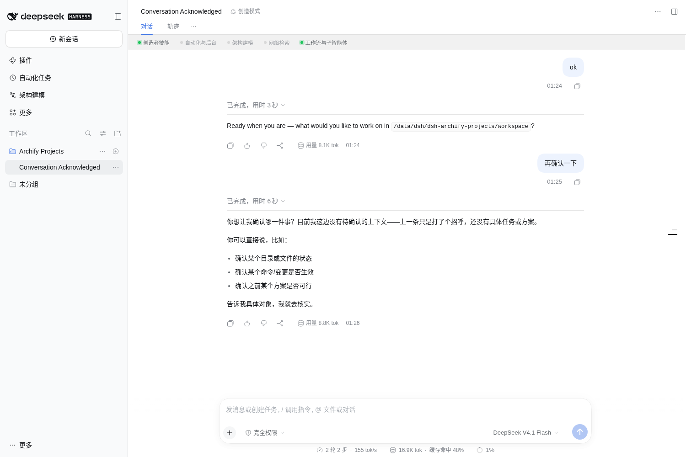
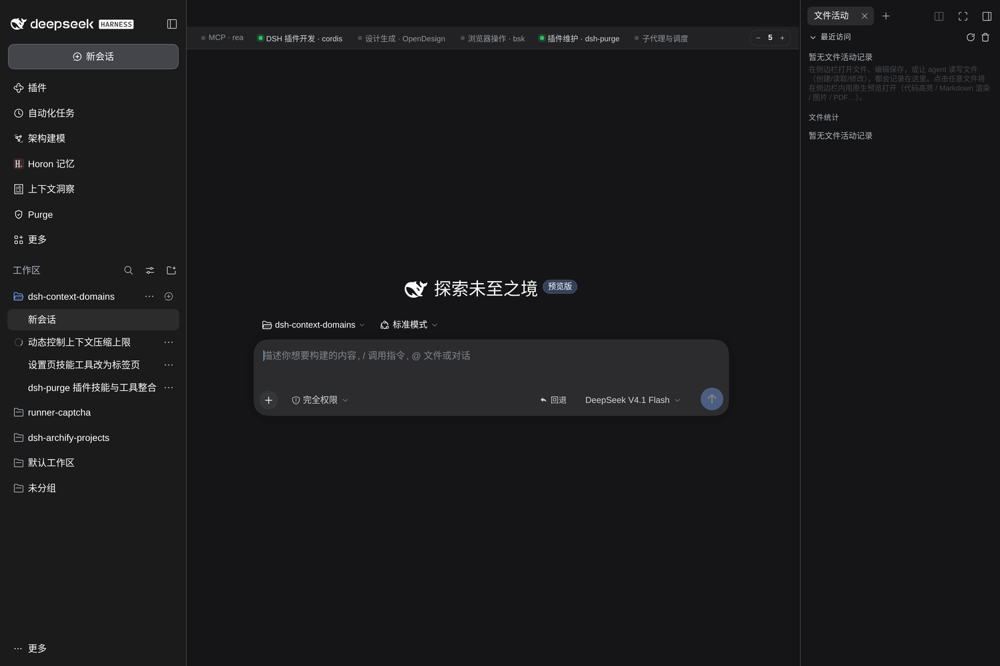
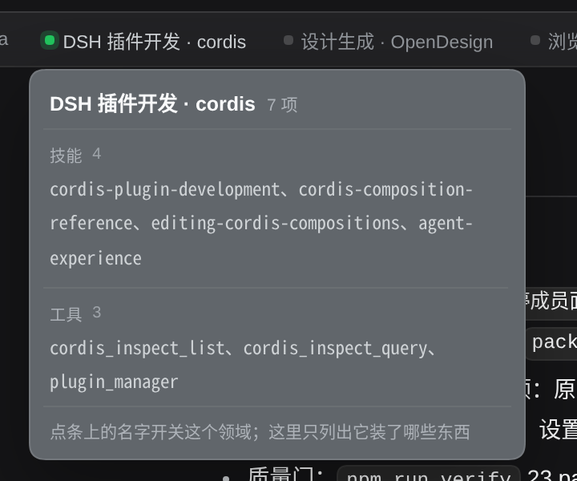
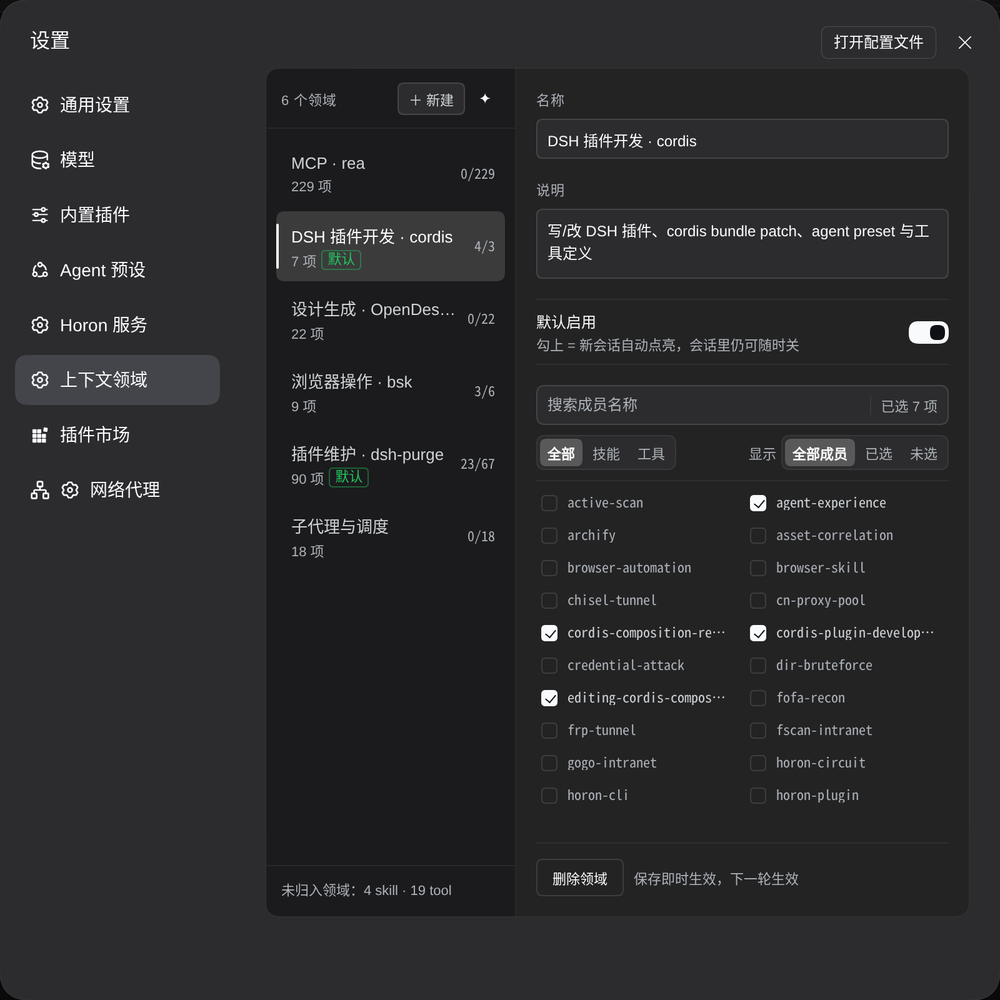

# dsh-context-domains

[](https://github.com/guicaiyue/dsh-context-domains/actions/workflows/verify.yml)
[](https://www.npmjs.com/package/dsh-context-domains)
[](LICENSE)

把一组 skill / tool 归成一个「领域」，在**会话顶部一条横条**里整块开关。

- **领域**：一个领域里可以同时装 skill 和 tool，概念上不区分类型；加载时才按类型分流
  （skill 从模型目录里摘掉、tool 从工具表里移除）。
- **领域条**：会话里、会话头正下方一行，`● 名称`，绿点=已加载、灰点=未加载，点一下开关；
  悬停展开成员（技能/工具两段，名字用顿号连起来）。新会话与对话是同一个位置。
- **压缩阈值计数器**：领域条最右边 `− 5 +`，中间是数字、单位 10 万 token（2 = 20 万，最低值）。
  它就是上下文压缩的触发线：到数就压，**改完下一轮生效，不用重启 dsh**。
- **设置 → 上下文领域**：左列领域清单，右侧 `搜索 → 技能/工具页签 + 显示开关 → 成员列表`，
  显示开关可切「全部成员 / 已选 / 未选」；新建领域默认勾上「默认启用」。不想一条条勾时，
  点左列 `＋ 新建` 旁的 `✦`，弹窗里是给 AI 的归类 prompt，一键复制。



---

## 效果

> 真机运行截的，被测对象就是这个插件自己。

**在真实会话里的位置** —— 会话头正下方一条，不占输入区、不挡消息：



**新会话也一样** —— 开会话前就能定好这次要哪些能力：



**一个领域里同时装技能和工具** —— 悬停展开，名字用顿号连起来（这个领域：技能 4 项、工具 3 项）。
成员多的领域不会把弹层拉到遮住半个对话区：上限是视口 55%，头（领域名 + 项数）和尾（那条操作提示）
固定，中间清单自己滚：



**设置 → 上下文领域** —— 左列领域清单（项数、已选/总数、默认标记）；右列是编辑器：
名称、说明、默认启用、搜索成员，然后「全部 / 技能 / 工具」页签与「全部成员 / 已选 / 未选」筛选：



---

## 安装

```bash
# npm（推荐：预构建，跳过 allowBuilds 构建授权）
dsh plugin --profile web add dsh-context-domains

# 或 GitHub Release 上的 tarball
dsh plugin --profile web add https://github.com/guicaiyue/dsh-context-domains/releases/latest/download/dsh-context-domains.tgz

# 本地开发
dsh plugin --profile web add link:/workspace/dsh-context-domains
```

装完重启 dsh。**Host 侧代码（`index.js` / `lib/**` / `cordis.patch.yml`）改动必须重启**，
只改 `client.js` 走热更。

---

## 机制

| 面 | 做法 |
|---|---|
| tool 屏蔽 | `agent.ctx.tools.restrict({ deny })`，schema / 查找 / 执行三处一致移除 |
| tool 兜底 | `agent.ctx.tools.guard(...)`，同步、顺序无关地拒绝 |
| skill 屏蔽 | 在 agent scope 用同名 runtime skill 重投，`modelInvocable:false` → 从模型目录消失，`/名字` 仍可用 |
| skill 兜底 | `guard` 按名拒绝 `skill` 调用 |
| 技能全关 | 额外摘掉 `skill` 工具（目录本来也会是空的） |

会话级选择存在 `$DSH_HOME/context-domains/state.json`（原子写、串行写、坏文件自动备份）。
数据结构：`Domain { id, name, icon?, description?, defaultOn, members[{type,name}] }`、
`sessions[id] = { domains: string[], excluded: {skills,tools} }`、
`compaction = { budgetTokens, at }`；v0.2 的 `skills/tools` 两串会在读取时自动合并。

## 压缩阈值（条最右边那个计数器）


条最右端的 `− 5 +`：左减右加、中间是数字，**单位 10 万 token**（`5` = 50 万，`2` = 20 万是下限）。
到数就压，改完下一轮生效，不用重启；悬停能看到换算、已接管几个压缩引擎、以及降级原因。

上下文压缩由 `compaction-basic` 决定，判定只有一句：`measurement.totalTokens >= thresholdTokens`，
而 `thresholdTokens = floor(min(window × thresholdRatio, window − 输出预留 − headroomTokens))`。
它的 config 装载时就被 deepFreeze，又挂在 preset 的 isolate 组里（profile 的 `cordis.patch.yml`
够不到），所以静态改阈值两条路都得重启。

这里改成运行期接管：给每个 `(provider, model)` 造一条精确的 `modelPolicies` 覆盖
（`thresholdRatio: 1`、`headroomTokens = 窗口 − 输出预留 − 预算`），解出来阈值就等于预算本身；
`modelPolicies` 是每次 `compactPressure` 现查的，所以重写引擎实例的 `config` 立刻生效。

- **引擎怎么找**：preset 是按需挂载的，引擎在 isolate realm 里，`ctx.get('compaction')` 拿不到。
  按 `ctx.reflect.store` 扫符号，取 `name === 'compaction'` 且 fiber 已激活的实现。
- **多引擎**：每个挂着的 preset（standard / ptc / minimal / 自定义）各有一个引擎，全部接管，同一个预算。
- **会话无关**：预算是全局的（引擎按 preset 一个、多会话共用），条在哪个会话上都改同一个数。
- **降级**：模型没声明 `contextWindow`、`llm` 服务不可见、还没有引擎挂载（冷启动尚无会话）时，
  阈值回落到该模型的原生判定，并在 `snapshot.compaction.degraded` 里如实列出原因（条上的数字变琥珀色）。
- **预算高于模型窗口**：会贴住物理上限（`window − 输出预留`），`snapshot` 里 `clamped: true`；
  真超了仍由原生的 context-overflow 恢复兜底。

## API

`/context-domains/api/{health,snapshot,catalog,domains,toggle,exclude,probe,compaction}`，全部经 `requestRejection` 栅栏。
`POST /toggle` 只需要 `{ sessionId, domainId, enabled }`（v0.3 起没有 `kind`）。
`POST /compaction` 收 `{ tokens }`（单位 10 万，最低 2）或 `{ budgetTokens }`（绝对值，收进 20 万～1000 万）。

## 配置

| 键 | 默认 | 说明 |
|---|---|---|
| `skillGate` | `shadow` | `shadow`=按域过滤目录；`coarse`=只在全关时摘 `skill` 工具；`off`=不干预 |
| `protectedTools` | `["present"]` | 永不被领域关掉的工具 |
| `allowEmptyToolSet` | `false` | 是否允许把工具全关 |
| `tokenEstimate` | `chars` | 成本估算口径（字符/4），只影响 API 里的数字 |
| `managedPresets` | `[standard, ptc, minimal, cordis]` | 只治理这些 preset 的会话 |
| `manageUnknownPresets` | `false` | 认不出的 preset 一律不管 |

## 只管自己的会话：preset 治理门

第三方插件会为自己的受限 agent 声明 preset（例如 `dsh-archify-projects` 的 `archify-projects`，
preset 里带私有的 skill 供给与工具白名单）。领域插件若对它也装 `restrict`/`guard`，
就会把它自带的那份供应按「我的领域没开」判成违规 —— 实测 archify 的出图会话里
`skill: archify` 被拒、整轮跑空（59 步、5M token 白烧）。

所以默认**只治理随包发布的四个内置 preset**，认不出的就退出治理：

```yaml
config:
  managedPresets: [standard, ptc, minimal, cordis]   # 默认值
  manageUnknownPresets: false                        # 认不出的 preset 一律不管
```

`/snapshot` 的 `session.managed` 会告诉界面这个会话归不归领域管；不归管时条子照常显示（只读状态），
`skillGate` 为 `unmanaged`。

---

## 开发（dsh-dev 容器）

```bash
docker exec dsh-dev dsh plugin --profile web add link:/workspace/dsh-context-domains
docker compose restart dsh
curl -s -b <cookie> http://127.0.0.1:3080/context-domains/api/health
```

无构建步骤（Host 与 Client 都是纯 ESM）。

## 测试

```bash
npm run verify                                     # 语法检查 + 全部 *.test.*（CI 跑这条）
npm run test:integration                           # 打到跑着的 dsh（默认 127.0.0.1:3080 + cookie jar）
node test/e2e/mask.mjs http://127.0.0.1:3080       # 端到端：关领域 → maskProbe 全为 false
node test/e2e/mcp.mjs  http://127.0.0.1:3080       # 端到端：MCP 工具整块装卸（需第三方来源）
```

`test/api.test.mjs` 是集成测试：找不到 cookie jar 时整组跳过，所以 CI 里跑的是
纯函数 + 迁移那 10 项（`npm run test` 会显示 `skipped 5`）。

## 发版（git workflow）

一次发布 = 一次标签推送，其余全交给 CI：

```bash
npm version patch --no-git-tag-version     # 或手工改 package.json 的 version
git commit -am "chore: release v0.3.1"
git tag v0.3.1 && git push origin main --tags
```

| 触发 | workflow | 干什么 |
|---|---|---|
| push / PR 到 `main` | [`verify.yml`](.github/workflows/verify.yml) | `npm run verify` + `npm pack --dry-run` |
| 推 `v*` 标签 | [`release.yml`](.github/workflows/release.yml) | 质量门 → 版本与标签一致性检查 → 打包 → 建 Release（带版本号 tgz + 稳定别名 `dsh-context-domains.tgz` + `SHA256SUMS.txt`）→ 有 `NPM_TOKEN` 就 `npm publish` |

- 标签与 `package.json` 的 `version` 不一致时任务直接失败，不发版。
- 市场条目指向稳定别名 `releases/latest/download/dsh-context-domains.tgz`，发版不用改 YAML。
- npm 发布细节与 2FA 处理见 [`docs/PUBLISH.md`](docs/PUBLISH.md)；上架流程见
  [`docs/market/README.md`](docs/market/README.md)。

## 目录

| 路径 | 作用 |
|---|---|
| `index.js` | 插件入口（`apply` → `createRuntime`） |
| `lib/store.js` | 会话状态持久化（单文档、串行写、原子写、迁移） |
| `lib/catalog.js` | 发现 skill / tool（全局 + preset 作用域），建域建议 |
| `lib/resolve.js` | 纯函数：选择 → 成员 → 允许/拒绝/遮蔽计划 |
| `lib/apply.js` | 真正装卸：`restrict` + `guard` + skill 重投，按会话串行 |
| `lib/http.js` | `/context-domains/api/*` |
| `client.js` | 领域条、成员弹层、设置页 |
| `docs/` | 发布与上架文档 |

设计与实现记录见 [`DESIGN.md`](DESIGN.md)、契约见 [`SPEC.md`](SPEC.md)。

## 验收：第三方来源（MCP / 外部 skill 提供方）

一次性验收用的第三方来源已撤除（profile patch 里那 4 行已删，容器重启后 `mcp__*` 与 office/badge 技能都不再出现）。
要复跑这套验收，把下面几行加进 `/data/dsh/profiles/web/cordis.patch.yml` 的 **`insert:` 下面**
（直接放顶层会被当成「按 id 覆盖已有条目」而报 `patch: entry "..." not found`）：

```yaml
- insert:
    - id: mcp-memory
      name: "@deepseek-ai/dsh-mcp-client"
      config: { serverName: memory, transport: stdio, command: npx,
                args: ["-y", "@modelcontextprotocol/server-memory"],
                env: { MEMORY_FILE_PATH: /data/dsh/mcp-memory.jsonl } }
    - id: mcp-fs
      name: "@deepseek-ai/dsh-mcp-client"
      config: { serverName: fsdemo, transport: stdio, command: npx,
                args: ["-y", "@modelcontextprotocol/server-filesystem", "/workspace"] }
    - id: skill-office
      name: "@deepseek-ai/dsh-skill-office"
    - id: skill-badge
      name: "@deepseek-ai/dsh-skill-badge"
```

```bash
docker compose restart dsh
node test/e2e/mcp.mjs http://127.0.0.1:3080   # 建混装领域 → 开关 → 断言 → 自动删除
```

当时的实测（领域 = 3 skill + 4 MCP 工具）：

| 检查 | 结果 |
|---|---|
| 目录发现 | 13 skill（filesystem 4 / dsh-office 7 / dsh-badge 1 / archify 1）+ 64 tool（含 25 个 `mcp__*`） |
| 开启 | `effective.tools` 出现 4 个 `mcp__memory__*`，`effective.skills` 含 3 个 skill，`missing` 为空 |
| 关闭 | 4 个 MCP 工具进 `deniedTools` 且从 `visible.tools` 消失；3 个 skill `maskProbe.modelInvocable=false` |
| 规模 | 16 个 `mcp__fsdemo__*`：关闭 → visible 0 / denied 16；开启 → visible 16 |
| 界面 | 点芯片双向切换，`masked` 从 `[]` → 三个 skill 名 → `[]` |

## License

[MIT](LICENSE)
